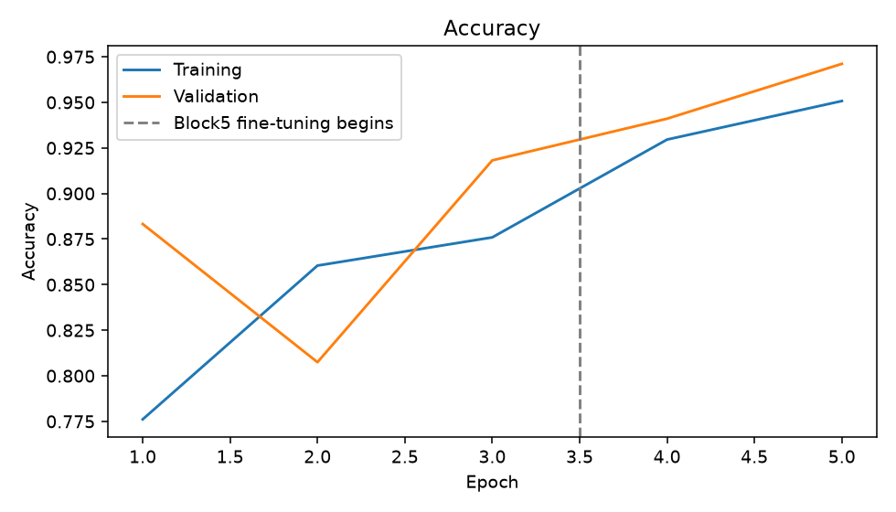
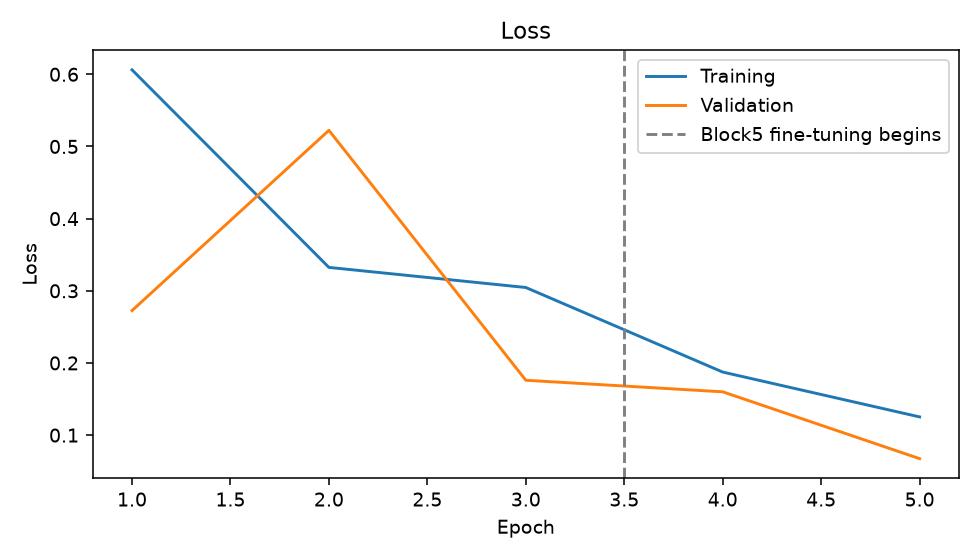

# Understand Your VGG16 Crop and Weed Project

A beginner study guide for Nalacherla Shravan Kumar, 23EG110C43, Roll Number 43.

This guide assumes that you are starting Deep Learning from the beginning. It explains what the project does, how the model learns, what the files contain, how to read the results, and how to explain the work in class.

The completed five-epoch run achieved 97.71% test accuracy on 831 held-out images. Its test loss was 0.0760 and ROC AUC was 0.9918.

## How to study this guide

First read pages 2–9 to understand the task and the model. Next read pages 10–13 with the results slides open. Then use pages 14–17 to run the project and practise the presentation. Finish with the viva questions and the glossary.

## The project in one sentence

I adapted an ImageNet-pretrained VGG16 convolutional network to classify a seedling photograph as Crop or Weed, then measured its performance on images kept separate from training.

## What you should be able to explain

You should know why the dataset is split, why VGG16 is pretrained, what changes during the two training phases, and what the test metrics mean. You do not need to memorise every line of code before you understand those ideas.

Study project completed locally on Windows using Python 3.11 and TensorFlow. Dataset: V2 Plant Seedlings. Execution date: 13 October 2026.

# 1 What Was Built and Why

## The practical problem

A crop is a plant grown intentionally, such as maize or wheat. A weed is a plant that is unwanted in a particular growing area. Young plants can look similar because many have small green leaves. This project studies whether a computer can separate the two image categories.

The project uses a fixed dataset mapping. Maize, Common Wheat and Sugar Beet are labelled Crop. The other nine dataset species are labelled Weed. This mapping defines the experiment; it is not a universal rule that every plant species is always a weed in every setting.

## Input and output

The input is one RGB seedling image. RGB means that each pixel has red, green and blue values. The output is one number between zero and one: the model’s Weed probability score. A score below 0.5 gives Crop. A score of 0.5 or above gives Weed.

## What changed in the repository

The earlier group project was converted into an individual Roll 43 project using VGG16 transfer learning. I prepared a separate Python environment, downloaded and verified the dataset, created disjoint splits, implemented the model, tested both training phases, ran full-dataset training, and generated results, a report and a stronger presentation.

The original course reference documents were retained under references/. The notebook and command-line trainer both call scripts/core.py, so they use the same data processing, architecture and evaluation logic.

A repository is a project folder with version history. Git records file changes and GitHub hosts the repository online. The source, documents and measured result artifacts can be reviewed there. Large raw images, the Python environment and the trained model remain local.

## What this experiment establishes

It measures classification performance on the specified held-out image split. It does not establish that an agricultural robot can safely remove plants in a real field. Field backgrounds, lighting and repeated plant identities need additional evaluation.

# 2 Artificial Intelligence Machine Learning and Deep Learning

## The three terms

Artificial Intelligence is the broad idea of making computers perform tasks that require useful decision-making or pattern recognition. Machine Learning is one way to do that: the computer learns patterns from examples rather than relying only on manually written rules. Deep Learning is Machine Learning built around neural networks with many processing layers.

## A simple comparison

A manually written image rule might say that a long narrow leaf means Crop. That rule would fail for some grasses and for unusual camera views. A learning model instead receives many labelled examples and adjusts numerical weights to make better predictions.

## What a neural network contains

A neuron is a small numerical operation. It combines input values using weights and usually passes the result through an activation function. A layer contains many such operations. Several layers can transform raw pixels into features and then into a decision. The biological term is an analogy; the model is a mathematical program.

## Supervised learning

This is supervised learning because training images have known labels. Crop is encoded as 0 and Weed as 1. The model predicts a score, compares it with the known label, calculates an error called loss, and updates its weights. The labels provide the supervision.

## Training and prediction

Training changes model weights using labelled examples. Prediction, also called inference, uses already learned weights to classify an image. Predicting one image does not train the model again. The saved .keras file stores the learned model for later inference.

A useful analogy is a student learning from practice questions and then answering a new question. The training examples are the practice material. The test set is the final exam that must remain separate.

# 3 How a CNN Reads an Image

## Pixels become numbers

An image is a grid of numbers. This project resizes every image to 224 by 224 pixels and uses three colour channels. One image therefore has shape 224 × 224 × 3. A tensor is a multidimensional array of numbers; a batch of four images has shape 4 × 224 × 224 × 3. Resizing creates a consistent shape without adding new information.

## Convolution and filters

A convolutional layer moves small learned filters across the image. A filter is also called a convolution kernel. It combines nearby values and creates a feature map. Early layers can respond to edges or colour changes, and deeper layers combine patterns. These are examples of possible features, not a claim that every filter has a simple human-readable meaning.

## Why the same filter moves across the image

A useful leaf pattern can appear in different locations. Applying shared filter weights across locations lets a CNN detect a pattern without storing a different rule for every pixel position. CNN stands for Convolutional Neural Network.

## ReLU and pooling

ReLU is an activation that replaces negative values with zero while keeping positive values. For example, it changes −2 to 0 and keeps 3 as 3. It introduces nonlinearity. Pooling reduces spatial size. VGG16 uses max pooling: a region containing 2, 4, 1 and 3 would produce 4. These are teaching examples, not model measurements.

## From feature maps to a decision

The convolution base extracts features. A classification head combines those features for the project’s two labels. The head is the part adapted to Crop and Weed. This separation is important because the base starts with features learned from ImageNet.

# 4 VGG16 and Transfer Learning

## What VGG16 is

VGG16 is a CNN introduced by Simonyan and Zisserman. Its original thirteen convolutional layers and three fully connected layers give sixteen layers with learned weights. Here, include_top=False removes the ImageNet classifier and keeps the convolution base.

## What ImageNet contributes

ImageNet is a large labelled image dataset. Its learned VGG16 weights provide an existing visual feature extractor. The new head still needs to learn the Crop and Weed decision; pretrained weights alone do not establish this project’s performance.

## Transfer learning

Transfer learning reuses knowledge from another task. Here, a new binary head learns from plant images using pretrained VGG16 features. This avoids learning every visual feature from random weights on a much smaller dataset.

## Frozen weights

Freezing a layer means that training does not update its weights. The frozen layer still processes images and produces features. During phase one, all VGG16 layers are frozen and the new head learns the binary classification task.

## Fine tuning

Fine-tuning allows selected pretrained weights to change slightly for the new task. During phase two, only VGG16 block5 is enabled, while blocks1–4 stay frozen. The classification head remains trainable. A much smaller learning rate protects the useful pretrained features from large changes.

VGG16 names the pretrained backbone. The project’s new binary head replaces the original ImageNet head.

## The five convolution blocks

| Block | Conv layers | Filters | Shape after pooling |
| --- | --- | --- | --- |
| 1 | 2 | 64 | 112 × 112 × 64 |
| 2 | 2 | 128 | 56 × 56 × 128 |
| 3 | 3 | 256 | 28 × 28 × 256 |
| 4 | 3 | 512 | 14 × 14 × 512 |
| 5 | 3 | 512 | 7 × 7 × 512 |

VGG16 uses 3 × 3 convolution filters. Each block ends in 2 × 2 max pooling. The table shows how spatial size decreases while the number of feature channels increases.

# 5 Understand the Dataset

The verified V2 Plant Seedlings dataset contains 5,539 RGB images from twelve species. Crop contains 973 images and Weed contains 4,566 images. The Weed class is much larger, so accuracy alone can hide poor recognition of crops.

| Species | Class | Images |
| --- | --- | --- |
| Maize | Crop | 257 |
| Common Wheat | Crop | 253 |
| Sugar Beet | Crop | 463 |
| Black-grass | Weed | 309 |
| Charlock | Weed | 452 |
| Cleavers | Weed | 335 |
| Common Chickweed | Weed | 713 |
| Fat Hen | Weed | 538 |
| Loose Silky-bent | Weed | 762 |
| Scentless Mayweed | Weed | 607 |
| Shepherd’s Purse | Weed | 274 |
| Small-flowered Cranesbill | Weed | 576 |

## What was verified

The verifier decoded every image and checked the species counts. The downloaded archive contained two species-folder trees. The downloader selected one complete tree so the dataset was not counted twice. It also normalised an incorrectly decoded apostrophe in a folder name.

## Source and limitation

The dataset comes from Kaggle’s V2 copy of the Aarhus Plant Seedlings dataset and uses CC BY-SA 4.0. Images have controlled backgrounds, and multiple growth-stage images can depict the same plant. These facts limit how confidently the result can be transferred to real fields.

# 6 Splitting and Preprocessing

## Training validation and test sets

Training images update the weights. Validation images measure progress and select the best checkpoint. Test images measure the selected model’s final performance. Mixing these roles would give an unfair estimate of how well the model handles unseen data.

| Partition | Crop | Weed | Total |
| --- | --- | --- | --- |
| Training | 681 | 3196 | 3877 |
| Validation | 146 | 685 | 831 |
| Test | 146 | 685 | 831 |

The split is approximately 70% training, 15% validation and 15% test. Seed 42 fixes the random split. Stratification keeps similar Crop and Weed proportions in all three partitions. The code checks that image paths do not overlap between partitions.

## Data augmentation

Augmentation creates small variations during training: horizontal flips, small rotations, zoom and translation. The label remains the same. The split happens before augmentation, and these random transforms are disabled for validation and test images.

## VGG16 preprocessing

Pixel values remain in the original 0–255 range before VGG16 preprocessing. The preprocessing reverses RGB channels to BGR and subtracts ImageNet channel means. Dividing by 255 first would produce the wrong scale for this VGG16 convention. The saved model includes preprocessing so later predictions use the same conversion.

## One important limit

Disjoint image paths do not guarantee disjoint plant identities. Two different images can show the same plant at different growth stages. A stronger future experiment would split using verified plant identities rather than only image paths.

# 7 Your Model Layer by Layer

The backbone extracts visual features and the new head learns the binary decision. The model has 14,780,481 parameters in total. During the frozen-head phase, 65,793 parameters are trainable and the pretrained convolution parameters remain fixed. A Dense layer is fully connected: each output combines all values from the previous feature vector.

| Component | What it does |
| --- | --- |
| Input | Receives a 224 × 224 × 3 RGB image. |
| Training augmentation | Creates small random training variations. It is inactive during evaluation. |
| VGG16 preprocessing | Converts channel order and subtracts ImageNet means inside the model. |
| VGG16 convolution base | Produces feature maps of shape 7 × 7 × 512 using its thirteen convolution layers. |
| Global average pooling | Averages each feature map, giving a vector of 512 values. |
| Dense 128 with ReLU | Learns combinations of the 512 features for the new task. |
| Dropout 0.5 | Randomly zeros about half the head activations during training to reduce reliance on particular units. |
| Dense 1 with sigmoid | Produces a Weed score between zero and one. |

## Why global average pooling

Averaging each map creates a compact feature vector. Flattening every position would instead produce 25,088 values before the dense head. The compact pooling head uses fewer new parameters and is practical for a small transfer-learning dataset.

## What dropout does

Dropout affects feature activations during training. It does not discard half the training images or remove half the stored weights. During normal prediction, dropout is disabled and the head uses its learned features.

## Interpret the output

A Weed score of 0.8 would be classified as Weed because it exceeds 0.5. That is a teaching example, not a measured prediction. A sigmoid score should not be treated as a guaranteed or calibrated confidence level.

# 8 How the Model Learns

## One training step

A batch of images enters the model. The model computes predictions in a forward pass. Binary cross-entropy compares the scores with the known labels. Backpropagation calculates how trainable weights contributed to the loss. The Adam optimizer then adjusts those weights. This repeats for all training batches.

A gradient describes how loss changes when a weight changes. Backpropagation efficiently computes these gradients through the layers. Adam uses recent gradient information to adapt updates for individual weights, with the learning rate setting the overall update scale.

## Epoch batch and learning rate

An epoch is one pass through the training set. A batch is a small group processed in one step. With 3,877 training images and batch size four, one epoch has 970 training steps; the last batch is smaller. Learning rate controls the size of weight updates. It is a configured setting, not an accuracy value.

| Setting | This measured run |
| --- | --- |
| Head phase | 3 epochs, all VGG16 weights frozen |
| Fine-tuning phase | 2 epochs, block5 and head trainable |
| Total measured budget | 5 epochs on the full training partition |
| Batch size and input | 4 images, each 224 × 224 RGB |
| Head learning rate | 0.001 |
| Fine-tuning learning rate | 0.00001, one hundred times smaller |
| Optimizer and loss | Adam and binary cross-entropy |
| Class weights | Crop 2.847, Weed 0.607 |
| Random seed | 42 |
| Hardware | AMD Ryzen 3 5300U, CPU execution |

## Why class weights

There are far fewer crop images. Balanced training class weights make a crop example contribute more to loss than a weed example. They are calculated only from training labels. They do not create more images, alter the held-out label counts, or change the ordinary accuracy calculation.

## Why only five epochs

This is a stated local CPU run budget, not a claim that five is the optimum number. The code supports up to ten head epochs and five fine-tuning epochs. Larger budgets take longer and should be evaluated using validation performance.

# 9 Loss Accuracy and Evaluation Metrics

## Loss and accuracy are different

Accuracy is the fraction of predictions with the correct class after applying the 0.5 threshold. Binary cross-entropy loss also considers the score’s strength. A confidently wrong score receives a larger penalty than a less confident wrong score. Two models can therefore have similar accuracy but different loss.

## Why accuracy alone is insufficient

The test set contains 685 weeds and 146 crops. A rule that always says Weed gets 685 of 831 images correct: 82.43% accuracy. Yet its Crop recall is zero. This is a calculated baseline, not your VGG16 result. Class-specific metrics reveal whether the model actually recognises crops.

## Precision and recall

Crop precision asks: of the images predicted as Crop, how many really are crops? Crop recall asks: of all actual crop images, how many were identified as Crop? The same definitions apply separately to Weed. A crop predicted as Weed lowers Crop recall and could matter in a future weed-removal system.

## F1 score and support

F1 combines precision and recall using their harmonic mean: twice their product divided by their sum. It is high only when both are reasonably high. Support is the number of actual images for a class: 146 for Crop and 685 for Weed in this test set.

A macro average gives each class equal weight. A weighted average uses class support, so the larger Weed class contributes more. This evaluation average is different from the balanced class weights used in training loss.

## Confusion matrix

The matrix counts the four possible outcomes. Rows are actual labels and columns are predicted labels. The diagonal cells are correct predictions. The off-diagonal cells are mistakes. Read the row and column labels before interpreting any matrix.

## ROC AUC

ROC means Receiver Operating Characteristic, and AUC means area under the curve. ROC AUC summarises how well scores rank Weed images above Crop images across thresholds. AUC of 0.5 corresponds to chance-like ranking, while 1.0 is perfect ranking on the evaluated data. It differs from accuracy at the fixed 0.5 threshold.

# 10 Read the Accuracy Graph

Open presentation slide 7. The horizontal axis is epoch number. The vertical axis is accuracy. The blue line is training accuracy and the orange line is validation accuracy. Both lines are measured from this run; the test accuracy is a separate final number.



| Epoch | Phase | Train accuracy | Validation accuracy |
| --- | --- | --- | --- |
| 1 | Head | 77.61% | 88.33% |
| 2 | Head | 86.05% | 80.75% |
| 3 | Head | 87.59% | 91.82% |
| 4 | Block5 | 92.96% | 94.10% |
| 5 | Block5 | 95.07% | 97.11% |

## What to look for

Increasing training accuracy means the model is fitting training examples better. Validation accuracy describes performance on its separate validation images. A growing training-versus-validation gap can suggest overfitting, but one fluctuation alone is not enough to diagnose it.

Validation accuracy can be higher than training accuracy because training uses augmentation and dropout, which make the training task harder. Validation uses unaugmented images and dropout is disabled. Epochs one through three train the head; epochs four and five fine-tune block5.

# 11 Read the Loss Graph and Checkpoints

Open presentation slide 8. Lower binary cross-entropy is generally better for the same evaluation setting. The blue curve is weighted training loss and the orange curve is unweighted validation loss, so their magnitudes are not directly interchangeable.



## What the callbacks do

A callback is an action performed during training. ModelCheckpoint saves the model when validation loss improves. EarlyStopping can stop a phase after three epochs without improvement and restore its best weights. ReduceLROnPlateau halves the learning rate after two epochs without improvement. With a three-plus-two budget, early stopping may not trigger.

The lowest measured validation loss across both phases was 0.0674. The test evaluation reloads the checkpoint selected using validation loss, rather than automatically using the last epoch.

## How to explain an increase in validation loss

Training is not guaranteed to improve every epoch. An increase can reflect less useful updates, overfitting or ordinary variation. Check the full curves and class metrics. In this run, the second head epoch had higher validation loss than the first, so the first checkpoint stayed eligible as the better model.

Checkpoint selection never uses the test set. This separation is what makes the final test result a more honest estimate than repeatedly selecting models on test accuracy.

# 12 Understand Your Actual Test Results

The completed five-epoch run achieved 97.71% test accuracy on 831 held-out images. Its test loss was 0.0760 and ROC AUC was 0.9918.

| Metric | Measured value |
| --- | --- |
| Correct predictions | 812 of 831 |
| Test accuracy | 97.71% |
| Test loss | 0.0760 |
| ROC AUC | 0.9918 |
| Always-Weed baseline | 82.43% accuracy, 0% Crop recall |

## Read the four counts

| Actual / Predicted | Crop | Weed |
| --- | --- | --- |
| Crop | 131 | 15 |
| Weed | 4 | 681 |

Of 146 actual crop images, 131 were correctly identified and 15 were predicted as Weed. Of 685 actual weed images, 681 were correctly identified and 4 were predicted as Crop.

| Class | Precision | Recall | F1 |
| --- | --- | --- | --- |
| Crop | 97.04% | 89.73% | 93.24% |
| Weed | 97.84% | 99.42% | 98.62% |

Read overall accuracy together with the class metrics. Crop recall is 89.73% and Weed recall is 99.42%. In this split, about one in ten crop images was misclassified, even though total accuracy was high. That gap matters when considering future crop protection.

## The appropriate conclusion

These are measured full-dataset results on the saved image split. They are not smoke-test scores. The split excludes identical paths, but repeated plant identities and controlled backgrounds remain limitations. A good test score here does not establish reliable performance in a field.

# 13 Understand the Code Without Memorising It

## Four Python ideas

A variable names a value, such as batch_size. A function is a named reusable action, such as predict_image. A class groups related data and actions; Experiment stores the datasets, model and results. An import loads definitions from a library or another project file.

```python
experiment = Experiment(config)
model = experiment.build()
head_history = experiment.train_head()
```

The first line creates an Experiment object using the configuration. The second builds its model. The third starts head training and stores the returned history in a variable. The equals sign assigns a value; it is not a mathematical claim that both sides were already equal.

| File or method | Purpose |
| --- | --- |
| scripts/dataset.py | Finds species images, maps labels and checks dataset counts. |
| Experiment.explore() | Verifies the dataset and saves distribution and sample plots. |
| Experiment.prepare() | Creates and saves disjoint splits, batches and class weights. |
| Experiment.build() | Loads ImageNet VGG16, adds the head and checks preprocessing. |
| train_head() and fine_tune() | Run the two phases with validation-based callbacks. |
| plot_history() and evaluate() | Save curves, reload the checkpoint, measure the test set and save predictions. |
| scripts/train_vgg16.py | Command-line entry point for the shared pipeline. |
| Main Jupyter notebook | Explains and runs the same pipeline in Jupyter. |

```python
notebooks/VGG16_Crop_Weed_Classification.ipynb
```

## What was tested

A small smoke run checked that the code executes, weights update, preprocessing is correct, and a saved model reloads consistently. A separate test checked that block5 updates while block1 remains frozen. All 25 notebook code cells executed in a smoke copy. Full-dataset training was run through the shared command-line pipeline; its measured results are the ones used in the final artifacts.

A smoke test is a quick correctness check on a tiny subset. It is not evidence of full-dataset model accuracy. The main notebook remains configured for normal full training.

# 14 Open and Run the Project

## Open PowerShell in the project folder

```powershell
cd 'C:\Users\shrav\Desktop\dl study proect\CNN-Crop-and-Weed-Classification'
```

The environment and dataset are already installed on this laptop. Use the repository’s Python executable below so the correct libraries are loaded.

## Open the notebook

```powershell
.\.venv\Scripts\python.exe -m jupyter lab
```

Select the Crop Weed VGG16 kernel. Open notebooks/Review_Completed_Results.ipynb and Run All to inspect the saved results without training. The main VGG16_Crop_Weed_Classification.ipynb explains the complete training pipeline; its Run All starts another experiment with maximum budgets of ten head epochs and five fine-tuning epochs.

## Predict one image using the saved model

```powershell
.\.venv\Scripts\python.exe scripts/predict_image.py `
  --image "data/raw/plant_seedlings/Sugar Beet/247.png"
```

This example uses an actual saved test-image path. The command prints Crop or Weed and the Weed probability. Replace the quoted image path with your own file path to try another image. Prediction loads the saved model and does not retrain it.

## Repeat the same full training budget if needed

```powershell
.\.venv\Scripts\python.exe scripts/train_vgg16.py `
  --batch-size 4 --threads 4 `
  --head-epochs 3 --fine-epochs 2
```

The backtick continues a PowerShell command on the next line. Re-running training writes a new checkpoint and new output files. CPU training is slow, so you do not need to rerun it just to read results or present the project.

## Where the completed results are

Open outputs/results_summary.json for the metric summary, outputs/training_history.json for epoch values, and outputs/test_predictions.csv for every test prediction. The .keras checkpoint is under models/. The revised presentation, report and this guide have Results or Explained in their names.

# 15 What to Say for Slides 1 to 6

Use these short explanations as practice notes. Understand each idea before trying to memorise the wording. The presentation’s speaker notes allocate ten minutes in total.

## Slide 1 Project title

My individual project is Crop and Weed Classification using VGG16. I used ImageNet transfer learning and evaluated the model on separate plant seedling test images.

## Slide 2 Problem statement

The task is to take one RGB plant image and predict Crop or Weed. Young plants can look similar, and the dataset contains many more weeds than crops. The objective is to adapt visual features and measure performance fairly.

## Slide 3 Dataset

The V2 Plant Seedlings dataset has 5,539 images and twelve species. Maize, Common Wheat and Sugar Beet form the Crop class, with 973 images. The other nine species form Weed, with 4,566 images. These photographs are original dataset samples.

## Slide 4 Preprocessing and split

I split the data before augmentation using seed 42 and binary stratification. There are 3,877 training images, 831 validation images and 831 test images. Images are resized to 224 by 224. VGG16 preprocessing uses raw 0–255 pixels, channel reversal and mean subtraction.

## Slide 5 Model architecture

The ImageNet VGG16 base extracts feature maps. Global average pooling reduces them to 512 features. A Dense 128 layer with ReLU and Dropout 0.5 learns the task. One sigmoid output gives the Weed score, with a threshold of 0.5.

## Slide 6 Hyperparameters

The measured local run used batch size four. First I trained the head for three epochs with the base frozen at learning rate 0.001. Then I fine-tuned block5 for two epochs at 0.00001. Class weights address imbalance, and validation loss chooses the saved checkpoint.

# 16 What to Say for Slides 7 to 11

## Slide 7 Accuracy results

The curves show training and validation accuracy across all five epochs. Blue is training and orange is validation. The measured test accuracy is 97.71% on 831 held-out images. The test set was not used to select the model.

## Slide 8 Loss results

The loss graph shows binary cross-entropy. Lower validation loss determines the best checkpoint. The measured test loss is 0.0760, and ROC AUC is 0.9918. Training loss uses class weights, while validation loss is unweighted, so I interpret trends rather than assuming the two values should match.

## Slide 9 Confusion matrix and class metrics

Rows are actual labels and columns are predicted labels. Diagonal cells are correct predictions. 15 crops were predicted as Weed, and 4 weeds were predicted as Crop. Precision, recall and F1 describe each class separately, which is important because Weed is the majority class.

## Slide 10 Sample predictions

These are actual test photographs with the true label, predicted label and saved Weed score. I included correct examples and errors. The score explains the thresholded decision, but it is not a calibrated guarantee of correctness.

## Slide 11 Conclusion

The project implements a complete local transfer-learning pipeline and reports measured test results. I also compare accuracy with the 82.43% majority-Weed baseline. Controlled backgrounds and repeated plant identities limit generalisation. Future work should verify plant-level splits and evaluate real field images.

## If you forget a technical term

Return to the simple story: images become features, the head learns two labels, validation selects a model, and separate test images measure the result. Explain the idea in plain words before giving the term.

## Claims to state accurately

This run used pretrained ImageNet weights and five measured epochs. It was executed on the CPU, and the split is at image level. Explain those facts directly rather than saying that every layer was trained from scratch or that field reliability has already been established.

# 17 Viva Questions About the Model

## 1 What is the aim of your project

To classify a seedling photograph as Crop or Weed using VGG16 transfer learning and evaluate the selected model on a separate test partition.

## 2 Why did you use a CNN

CNNs learn spatial patterns from images using shared filters. This task is image classification. The uploaded LSTM and GRU decks were layout references; those sequence models are not the architecture used in this project.

## 3 Why VGG16 and ImageNet weights

VGG16 provides an established pretrained visual feature extractor. ImageNet weights give a useful starting point when the plant dataset is much smaller. I then train a head for the new binary task.

## 4 Why remove the original top layers

The original classifier predicts ImageNet categories. include_top=False removes it so I can attach global average pooling and a new Crop/Weed head.

## 5 Why one sigmoid output

There are two mutually exclusive classes. One sigmoid score represents Weed, with Crop selected below the threshold. Binary cross-entropy is appropriate for this label encoding.

## 6 Why freeze and then fine tune

Freezing lets the new head learn without immediately changing pretrained features. Fine-tuning block5 later adapts high-level features using a smaller learning rate, while earlier blocks stay fixed.

## 7 Why Dropout 0.5 and global average pooling

Dropout reduces dependence on particular head activations during training. Global average pooling creates a compact 512-feature vector and uses fewer new parameters than flattening all feature-map positions.

# 18 Viva Questions About Data and Results

## 8 Why have validation and test sets

Validation guides checkpoint selection and training decisions. Test images are held out until the selected model is evaluated. Using test performance to choose a model would make the final estimate less fair.

## 9 Why not divide image values by 255

This VGG16 preprocessing convention expects raw 0–255 pixels before reversing channels and subtracting ImageNet means. Dividing first changes the intended input scale.

## 10 What are class weights and why use them

They change training loss contributions so minority crop examples matter more. The weights are calculated from training labels only. They do not change the validation or test distributions.

## 11 Is high accuracy enough

No. Always predicting Weed would already get 82.43% accuracy on this test split while missing every crop. I therefore inspect Crop recall, Weed recall, precision, F1 and the confusion matrix.

## 12 What does five epochs mean

The model passes through the full training partition five times: three frozen-head epochs and two block5 epochs. It is the stated CPU budget for this measured run. The default code permits larger maximum budgets.

## 13 Are your results smoke test results

No. Smoke tests checked execution on tiny balanced subsets. The final metrics use 831 test images from the full 5,539-image dataset, after full-partition training.

## 14 What is the main limitation and future work

Different image paths may still show the same plant at different growth stages, and the backgrounds are controlled. Future work should verify plant identities for grouped splits, obtain field photographs and evaluate threshold choices on validation data.

# 19 Glossary and Reliable Reading

| Term | Plain meaning |
| --- | --- |
| Dataset | The collection of labelled examples. |
| Feature | A numerical representation of an image pattern. |
| Parameter or weight | A model value learned during training. |
| Hyperparameter | A setting chosen before training, such as batch size. |
| Epoch | One pass through the training partition. |
| Batch | A small group processed in one training step. |
| Optimizer | The method that updates trainable weights. |
| Checkpoint | A saved model selected during training. |
| Inference | Using learned weights to predict an image. |
| Overfitting | Fitting training-specific patterns that fail to generalise well. |
| Kernel in Jupyter | The Python process used to execute notebook code. |
| .venv | The isolated Python environment for this repository. |
| .ipynb | A notebook file containing explanation and code cells. |
| .keras | The saved model file used for later predictions. |
| CSV and JSON | Readable formats that store tables and structured results. |

## Sources to read after this guide

[TensorFlow tutorial on transfer learning and fine tuning](https://www.tensorflow.org/tutorials/images/transfer_learning)

[TensorFlow VGG16 preprocessing documentation](https://www.tensorflow.org/api_docs/python/tf/keras/applications/vgg16/preprocess_input)

[Simonyan and Zisserman VGG paper](https://arxiv.org/abs/1409.1556)

[Giselsson and colleagues Plant Seedlings dataset paper](https://arxiv.org/abs/1711.05458)

Project-specific facts come from scripts/core.py, outputs/dataset_splits.csv, outputs/training_history.json, outputs/results_summary.json and outputs/test_predictions.csv. The presentation uses measured output files, not the numbers in the two reference presentations.
